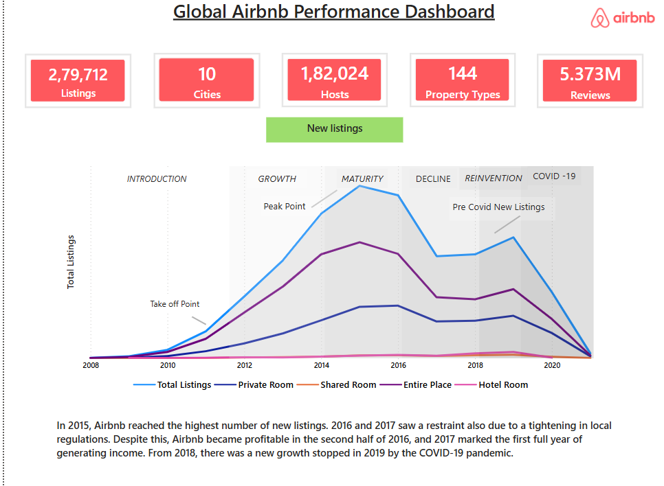
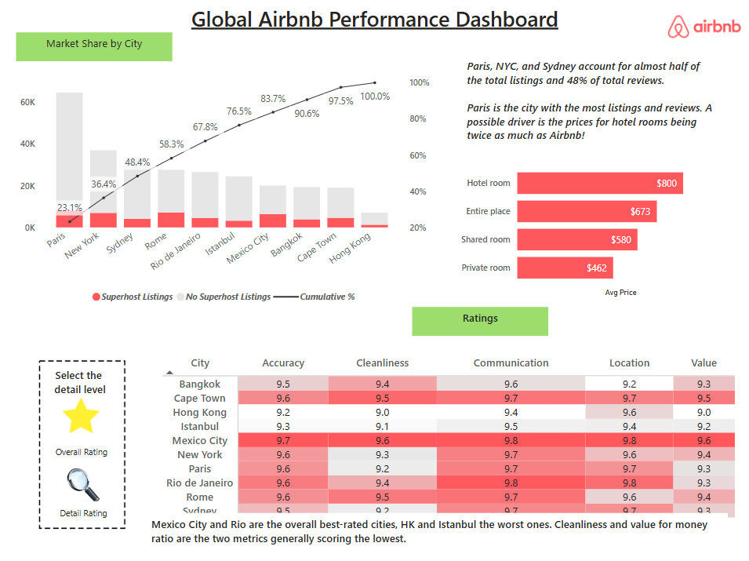
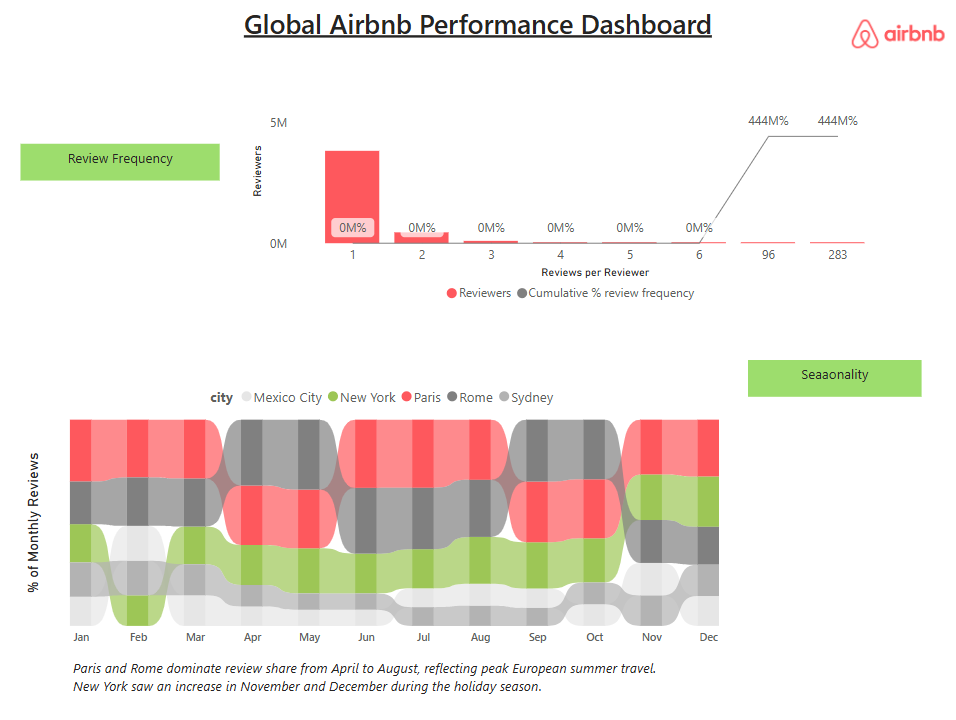

Global Airbnb Performance Dashboard (Power BI)
An interactive 3-page Power BI dashboard that looks at how Airbnb grew across 10 global cities: how listings grew over time, which cities dominate.

---

## 🧰 Tools Used

- Power BI Desktop
- DAX
- Power Query (data cleaning)

---

## 🔄 Project Workflow

1. Calculated columns to prepare and group the data.
2. DAX measures for the KPIs, cumulative %, averages and ratings
3. Bookmarks on the ratings page to toggle between overall and detailed rating views
4. Custom visuals: Pareto chart, heatmap table, ribbon chart, and KPI cards.

---

## ✨ Features

### 1. Page 1: Listings Growth Over Time
- Line chart of new listings from 2008 to 2021, split by room type (Entire Place, Private Room, Shared Room, Hotel Room)
- Airbnb's journey is marked in phases: Introduction → Growth → Maturity → Decline → Reinvention → COVID-19
- Key points: take-off around 2011, peak in 2015, a dip in 2016–2017 (tighter local regulations), new growth from 2018, then COVID-19 stopped it

### 2. Page 2: Market Share & Ratings
- Paris, New York and Sydney together make up almost half (48.4%) of all listings
- Average price by room type: Hotel Room ($800), Entire Place ($673), Shared Room ($580), Private Room ($462)
- Ratings heatmap by city across Accuracy, Cleanliness, Communication, Location and Value

### 3.Page 3: Review Frequency & Seasonality
- Review frequency: how many reviews each reviewer has written (most reviewers wrote just one)
- Seasonality ribbon chart: each city's share of monthly reviews
- Paris and Rome lead from April to August (European summer travel)

##  Dashboard Walkthrough--

